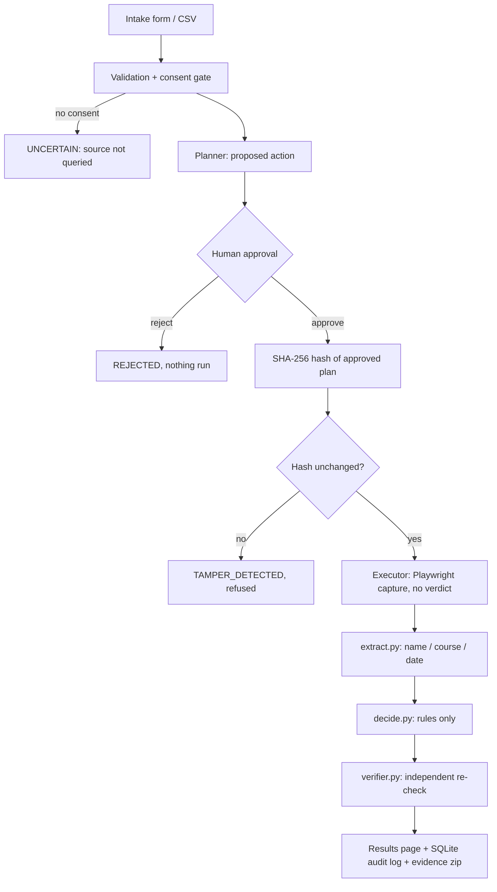

# Certificate Authenticity Checker

An agent that checks a credential against the issuer's public verification page. It plans an action,
**pauses for human approval**, executes it in a real browser, saves proof, decides with **deterministic rules**,
then has a **separate verifier** re-check its own result. When evidence is missing it answers `UNCERTAIN`; it never guesses.

> **Demo issuer = MOCK ISSUER (demo data).** `mock_issuer.py` is a local stand-in so every scenario is reproducible.
> It is not a real certificate authority. To use a real public page, add an entry to `sources.json` (see below).

## Architecture

| File | Job |
|---|---|
| `validation.py` | validates inputs before anything runs |
| `pipeline.py` | agent loop, approval, tamper check, idempotency (UNIQUE key), step log |
| `executor.py` | opens the page, saves screenshot + text + URL + time. **Never judges.** |
| `extract.py` / `decide.py` | read fields, then VERIFIED / MISMATCH / NOT_FOUND / UNCERTAIN with a reason |
| `verifier.py` | separate code path: valid PNG, page shows the entered ID, values re-read independently, rules re-run |
| `db.py` | SQLite tables: records, plans, executions, decisions, verifications, steps. Nothing is deleted |
| `app.py` | web UI (standard library only) |

## Decision rules
`NO_RECORD` -> NOT_FOUND. Blocked / timeout / error / missing field -> UNCERTAIN. Otherwise name `token_sort_ratio >= 90`,
course `token_set_ratio >= 85`, date exact (month-level if the issuer shows only month+year). All three -> VERIFIED, else MISMATCH
and the failing fields are named. The page's own badge or the word "VERIFIED" is never read.

## Run it (Windows PowerShell)
```powershell
python -m venv .venv
.\.venv\Scripts\Activate.ps1
pip install -r requirements.txt
playwright install chromium
python app.py            # open http://localhost:8080  (the mock issuer starts automatically on port 8000)
```
Scenarios and tests:
```powershell
python run_scenarios.py  # writes scenario_report.md and scenario_run/evidence
python -m pytest -q
```
Try in the UI: submit `GOOD1001 / Jane Doe / Machine Learning / 2024-03-15` with consent ticked, press **Approve & run**,
open the record. Then try `ZZZ999` (not found), a wrong name (mismatch), no consent (uncertain) and **Demo: tamper**.
Other mock IDs: `GOOD1002`, `TRAP2002` (green badge but different person), `BLOCK001` (captcha page).

## Adding a real issuer
Add an entry to `sources.json` with `verify_url` (use `{id}`), `labels` (the text labels the page prints before the name,
course, date and ID) and `not_found_phrases`, and add its key to the issuer list shown in the form. Run `spike.py` first to see
what the page really looks like. Only check credentials with the holder's consent. Captchas and logins are never bypassed:
they produce UNCERTAIN.

## Limits (read before trusting a result)
- It proves the issuer's page agrees with the claim. It cannot prove the page itself is genuine or not spoofed.
- Layout changes on a real issuer's page can break extraction; the result is then UNCERTAIN, not a guess.
- `token_set_ratio` is lenient about extra words ("Machine Learning" matches "Machine Learning Specialization").
- Scores use `rapidfuzz` if installed, otherwise a built-in `difflib` fallback with slightly different numbers.
- Executor is local Playwright only. A cloud browser (e.g. Browserbase) cannot reach `localhost`, so it is not included.
- The "Demo: tamper" button exists only to show the safeguard working.
